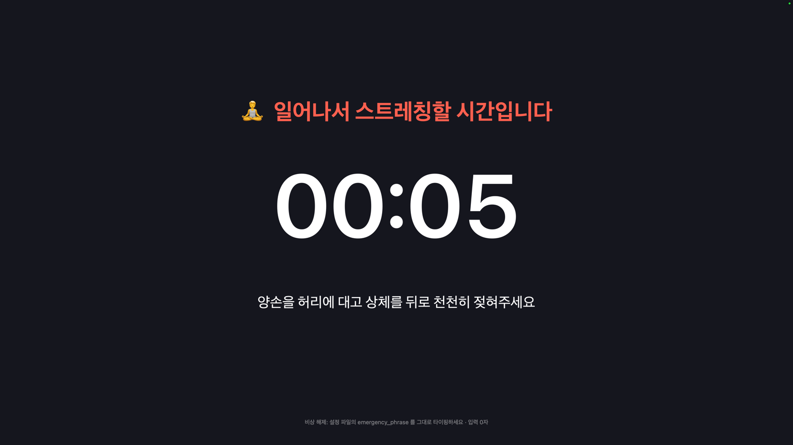

# Force Stretch

하루 종일 컴퓨터 앞에 앉아 있는 사람을 위한 **강제 스트레칭 알리미** (Rust, macOS / Windows).

정해진 주기마다 연결된 **모든 모니터를 전체 화면으로 가려서** 작업을 할 수 없게 만들고, 스트레칭 시간이 끝나야 화면을 돌려줍니다. 알림은 무시할 수 있지만, 화면이 가려지면 일어날 수밖에 없습니다.



| 플랫폼 | 상태 |
| --- | --- |
| macOS | 실사용 검증 완료 (다중 모니터, 전체화면 앱, 비상 해제) |
| Windows | **베타** — Windows 11 가상 머신에서 가림 화면·작업 표시줄 가림·주기 정확도를 확인했습니다. 실제 PC·다중 모니터는 아직입니다. [Windows 시험 체크리스트](#windows-시험-체크리스트)를 참고해 주세요. |

## 기능

- **상주 아이콘** — macOS는 상단 메뉴바에 남은 시간(`🧘 23:41`)을 표시, Windows는 작업 표시줄 트레이 아이콘(툴팁과 메뉴 첫 줄에 남은 시간)
- **강제 화면 가림**
  - 연결된 모든 모니터를 최상위 창으로 덮음 (스트레칭 도중 모니터를 연결/해제해도 다시 덮음)
  - macOS: 전체화면 앱·다른 데스크탑(Spaces) 위까지 덮고, Dock·메뉴바 숨김, `Cmd+Tab` 앱 전환 차단, `Cmd+Q` 등 단축키 무시
  - Windows: 저수준 키보드 훅으로 `Alt+Tab`, `Win` 키, `Alt+F4` 등 모든 키 입력 차단
  - 큰 카운트다운과 스트레칭 동작 안내(20초마다 교체)
- **사전 경고** — 시작 30초 전부터 macOS 메뉴바 아이콘이 `⚠️`로 바뀜
- **똑똑한 주기 계산**
  - 5분 이상(또는 스트레칭 시간 이상) 입력이 없으면 이미 쉰 것으로 보고 주기를 초기화
  - 잠자기에서 깨어나면 주기를 초기화
- **설정** — 메뉴에서 주기·시간을 바로 선택. macOS는 설정 창 제공, Windows는 설정 파일 직접 편집
- **안전장치**
  - 비상 해제 문구: 가림 중에 정해 둔 문구를 그대로 타이핑하면 해제 (한글 입력 상태에서도 동작, 비워두면 비활성)
  - 가림 화면이 예정 종료 시각보다 30초 이상 남아 있으면 프로세스가 스스로 종료 (UI와 독립된 감시 스레드)
  - macOS 강제 종료(`Cmd+Opt+Esc`), Windows `Ctrl+Alt+Del`은 막지 않음

## macOS

### 요구 사항

- macOS 12 이상
- [Rust](https://rustup.rs) (stable)

### 설치

```sh
git clone https://github.com/kaifacun/force-streach.git
cd force-streach
./install.sh
```

`install.sh`는 다음을 수행합니다.

1. 릴리스 빌드 후 `Force Stretch.app` 번들 생성 (`bundle.sh`)
2. `/Applications/Force Stretch.app`으로 복사
3. 로그인 시 자동 실행되도록 LaunchAgent(`~/Library/LaunchAgents/local.force-stretch.plist`) 등록 후 즉시 실행

메뉴에서 **종료**하면 다음 로그인 때까지 꺼진 상태로 유지되고, 비정상 종료 시에는 자동으로 다시 실행됩니다.

앱 번들만 만들고 싶다면 `./bundle.sh` (→ `target/Force Stretch.app`).

### 제거

```sh
./uninstall.sh
```

자동 실행 해제와 앱 삭제를 수행합니다. 설정 파일은 남겨 둡니다.

### 메뉴

메뉴바의 `🧘` 아이콘을 클릭하면 다음 메뉴가 열립니다.

| 메뉴 | 설명 |
| --- | --- |
| 다음 스트레칭까지 MM:SS | 현재 상태 표시 |
| 지금 스트레칭 시작 | 즉시 화면 가림 시작 |
| 1시간 일시정지 / 일시정지 해제 | 회의·발표 중에 사용 |
| 스트레칭 주기 | 20 / 30 / 45 / 50 / 60 / 90분마다 |
| 스트레칭 시간 | 1 / 2 / 3 / 5 / 10분 |
| 설정… | 주기·시간 직접 입력, 경고 시간, 자리 비움 초기화, 비상 해제 문구 |
| 설정 파일 열기… | `config.toml`을 기본 편집기로 열기 |
| 종료 | 앱 종료 |

### 시험 실행

5초 뒤 약 8초간 화면을 가리고, 끝나면 자동 종료됩니다. 설정 파일은 바꾸지 않습니다.

```sh
open -n -W "target/Force Stretch.app" --args --test
```

## Windows (베타)

### 받기

- [Releases](../../releases)에서 `force-stretch.exe`를 받거나,
- 직접 빌드: Windows에 [Rust](https://rustup.rs)를 설치한 뒤

  ```powershell
  cargo build --release
  # → target\release\force-stretch.exe
  ```

> 서명되지 않은 실행 파일이고, 스트레칭 중 키 입력을 막기 위해 전역 키보드 훅을 쓰며, 자동 실행을 켜면 레지스트리 Run 키에 기록합니다. 그래서 처음 실행할 때 SmartScreen 경고("Windows의 PC 보호")가 뜰 수 있고, 백신이 의심 파일로 표시할 수도 있습니다. SmartScreen에서는 **추가 정보 → 실행**을 누르면 됩니다. 걱정되면 소스에서 직접 빌드하세요.

`force-stretch.exe`를 원하는 폴더에 두고 실행하면 작업 표시줄 오른쪽 아래 트레이에 아이콘이 나타납니다. 트레이가 접혀 있다면 `^` 버튼 안에 있습니다.

### 메뉴

트레이 아이콘을 클릭하면 메뉴가 열립니다.

| 메뉴 | 설명 |
| --- | --- |
| 다음 스트레칭까지 MM:SS | 현재 상태 표시 (아이콘에 마우스를 올려도 표시) |
| 지금 스트레칭 시작 | 즉시 화면 가림 시작 |
| 1시간 일시정지 / 일시정지 해제 | 회의·발표 중에 사용 |
| 스트레칭 주기 / 스트레칭 시간 | macOS와 동일 |
| 로그인 시 자동 실행 | 체크하면 `HKCU\Software\Microsoft\Windows\CurrentVersion\Run`에 등록 |
| 설정 파일 열기… | 메모장으로 `config.toml` 열기 (저장 후 앱을 다시 실행해야 반영) |
| 로그 파일 열기… | 진단용 로그 |
| 종료 | 앱 종료 |

### 시험 실행

```powershell
.\force-stretch.exe --test
```

5초 뒤 약 8초간 모든 모니터를 가리고, 끝나면 자동 종료됩니다.

### Windows 시험 체크리스트

Windows 11 가상 머신(ARM64에서 x64 에뮬레이션)에서 일부 항목을 확인했습니다. 시험해 보시고 결과와 함께 로그 파일(`%APPDATA%\force-stretch\force-stretch.log`)을 이슈로 남겨 주시면 큰 도움이 됩니다. `--test` 실행 중에는 로그에 `진단:` 줄이 기록됩니다.

- [ ] 트레이 아이콘이 보이고, 클릭하면 메뉴가 열린다 (Windows 11은 새 아이콘을 `^` 안에 숨김)
- [ ] `--test` 실행 시 모든 모니터가 가려진다 (배율이 다른 모니터 포함)
- [x] 작업 표시줄까지 가려진다
- [x] 정해진 주기에 시작하고 정해진 시간 뒤에 끝난다 (시스템 시계가 바뀌어도 단조 시계 기준)
- [ ] 가림 중 `Alt+Tab`, `Win` 키, `Alt+F4`가 동작하지 않는다
- [ ] 한글 입력 상태에서도 비상 해제 문구를 타이핑하면 풀린다
- [ ] 스트레칭이 끝나면 키보드가 정상으로 돌아온다
- [ ] `Shift`나 `Ctrl`을 누른 채로 스트레칭이 시작돼도, 끝난 뒤 키가 눌린 채로 남지 않는다
- [ ] 터치패드 제스처(세 손가락 스와이프 등)나 작업 보기로 다른 가상 데스크탑으로 넘어가도 가림이 유지된다
- [ ] "로그인 시 자동 실행"을 켜고 재부팅하면 자동으로 실행된다

## 설정 파일

| OS | 위치 |
| --- | --- |
| macOS | `~/Library/Application Support/force-stretch/config.toml` |
| Windows | `%APPDATA%\force-stretch\config.toml` |

```toml
interval_secs = 3000      # 작업 주기 (초). 기본 50분
break_secs = 180          # 스트레칭(화면 가림) 시간 (초). 기본 3분
warn_secs = 30            # 시작 전 메뉴바 경고 시간 (초)
idle_reset = true         # 자리 비움 시 주기 초기화 여부
idle_reset_secs = 300     # 자리 비움으로 판단할 무입력 시간 (초)
emergency_phrase = "i promise i will stretch later"  # 비상 해제 문구. ""이면 비활성
```

설정 파일을 직접 고친 경우 앱을 다시 실행해야 반영됩니다. 메뉴나 설정 창에서 바꾼 값은 즉시 반영되고 자동 저장됩니다.

허용 범위: 주기 1분~24시간, 스트레칭 시간 10초~30분, 자리 비움 판단 2분~1시간.

같은 폴더의 `force-stretch.log`에 실행 기록이 남습니다.

## 구조

```
src/
├── main.rs            # 진입점: 설정 로드 후 OS별 run() 호출
├── common/            # OS 무관 로직
│   ├── config.rs      # 설정 구조체, OS별 경로, TOML 입출력
│   ├── schedule.rs    # 순수 스케줄러 (작업/일시정지/스트레칭 상태 머신) + 단위 테스트
│   ├── phrase.rs      # 비상 해제 문구 입력 버퍼 + 단위 테스트
│   ├── failsafe.rs    # UI와 독립된 감시 스레드
│   ├── log.rs         # stderr + 파일 로그
│   └── tips.rs        # 스트레칭 동작 안내 문구
├── macos/             # AppKit (objc2)
│   ├── mod.rs         # 메뉴바, 타이머, 키오스크 옵션
│   ├── overlay.rs     # 모니터별 가림 창, 키 입력
│   └── settings.rs    # 설정 창
└── win/               # Win32 (windows-rs)
    ├── mod.rs         # 트레이, 메뉴, 타이머, 자동 실행, 중복 실행 방지
    └── overlay.rs     # 모니터별 가림 창(GDI), 저수준 키보드 훅
```

```sh
cargo test                                         # 공통 로직 단위 테스트
cargo check --target x86_64-pc-windows-msvc        # macOS에서 Windows 코드 타입 검사
```

GitHub Actions(`.github/workflows/build.yml`)가 push마다 macOS·Windows에서 테스트와 빌드를 수행하고, `v*` 태그를 push하면 Releases에 `force-stretch.exe`와 `Force-Stretch-macos.zip`을 올립니다.

## 버전 관리

- 버전은 `Cargo.toml`의 `version` 한 곳에서만 관리합니다. macOS 앱 번들 버전도 여기서 읽습니다.
- 변경 내역은 [CHANGELOG.md](CHANGELOG.md)에 기록합니다.
- 릴리스: `Cargo.toml` 버전을 올리고 CHANGELOG에 항목을 추가한 뒤 `git tag v<버전> && git push origin v<버전>`. CI가 태그와 `Cargo.toml` 버전이 같은지 확인하고, CHANGELOG 해당 항목을 릴리스 노트로 씁니다.

## 한계

- 의지가 있다면 우회할 수 있습니다 (강제 종료, 비상 해제 문구, 다른 기기에서 원격 종료 등). 이 앱의 목적은 "일어나는 것이 가장 편한 선택"이 되게 만드는 것입니다.
- 앱 아이콘(실행 파일·앱 번들)은 아직 없습니다. Windows 트레이 아이콘은 실행 중에 그려서 씁니다.
- CI에서 만드는 macOS 빌드는 Apple Silicon 전용이며 서명·공증되지 않았습니다. 받은 앱이 열리지 않으면 우클릭 → 열기를 사용하세요.

## 라이선스

[MIT](LICENSE)
